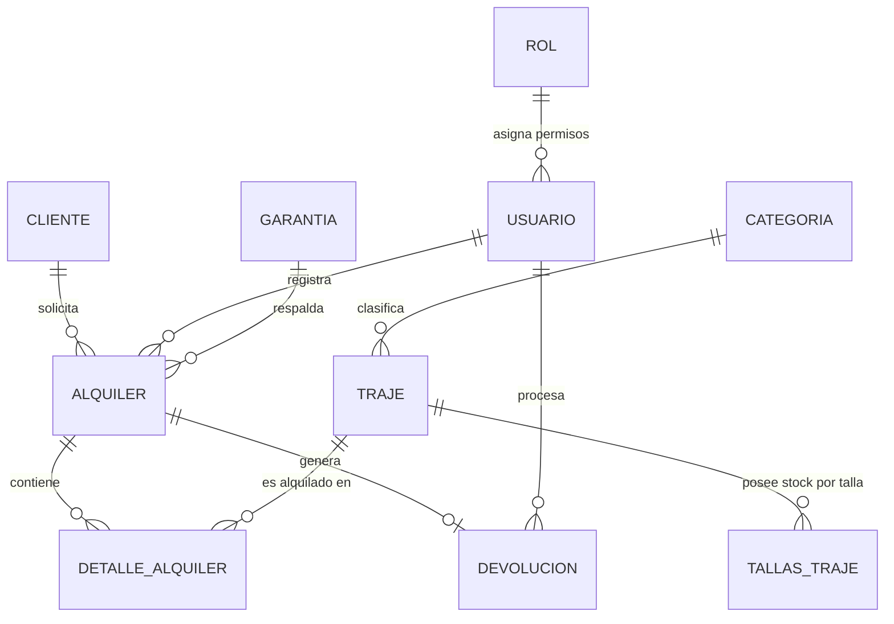

# 🗄️ Modelo y Diccionario de Base de Datos

El sistema utiliza **MySQL** como motor relacional con la base de datos `bd_alquiler_trajes`.

---

## 🏗️ Diagrama Entidad - Relación (Conceptual)

---

## 📋 Diccionario de Tablas

### 1. `rol`
Roles de acceso al sistema.
- `idRol` (INT, PK, AUTO_INCREMENT)
- `nombre` (VARCHAR(50)): Nombre del rol (`Administrador`, `Empleado`).

### 2. `usuario`
Cuentas de acceso de los colaboradores y administradores.
- `idUsuario` (INT, PK, AUTO_INCREMENT)
- `idRol` (INT, FK -> `rol.idRol`)
- `nombre` (VARCHAR(100)): Nombre del usuario.
- `apellido` (VARCHAR(100)): Apellido del usuario.
- `email` (VARCHAR(150), UNIQUE): Correo de inicio de sesión.
- `password` (VARCHAR(255)): Contraseña encriptada con Bcrypt.
- `created_at` / `updated_at` (TIMESTAMP)

### 3. `categoria`
Clasificación de los trajes y vestimentas.
- `idCategoria` (INT, PK, AUTO_INCREMENT)
- `nombre` (VARCHAR(100)): `tipicos`, `internacionales`, `disfraces`, `gala`.
- `descripcion` (TEXT): Alcance temático de la categoría.

### 4. `traje`
Catálogo de trajes disponibles en el negocio.
- `idTraje` (INT, PK, AUTO_INCREMENT)
- `idCategoria` (INT, FK -> `categoria.idCategoria`)
- `nombre` (VARCHAR(150)): Nombre comercial del traje (ej: *Caporal Macho Bordado Dorado*).
- `descripcion` (TEXT): Detalle y características del traje.
- `precio` (DECIMAL(10,2)): Precio unitario de alquiler en bolivianos (Bs.).
- `imagen` (VARCHAR(255)): Nombre de archivo de la fotografía en `public/img/`.
- `pieza` (VARCHAR(255)): Descripción de los accesorios incluidos.
- `cant_piezas` (INT): Cantidad total de componentes físicos.
- `estado` (VARCHAR(50)): `Disponible` o `Agotado`.

### 5. `tallas_traje`
Inventario desagregado por talla para cada traje.
- `idTalla` (INT, PK, AUTO_INCREMENT)
- `idTraje` (INT, FK -> `traje.idTraje`, ON DELETE CASCADE)
- `talla` (VARCHAR(10)): `XS`, `S`, `M`, `L`, `XL`.
- `stock` (INT): Unidades físicas disponibles en esa talla.

### 6. `cliente`
Personas, colegios o fraternidades que contratan el servicio.
- `idCliente` (INT, PK, AUTO_INCREMENT)
- `nombre` (VARCHAR(150)): Nombre completo del cliente o contacto.
- `ci` (VARCHAR(20)): Cédula de Identidad con extensión.
- `telefono` (VARCHAR(30)): Número de contacto o WhatsApp.
- `tipo_cliente` (VARCHAR(50)): `Colegio`, `Fraternidad`, `Público General`, `Coreógrafo`.
- `colegio` (VARCHAR(150), NULL): Nombre de la unidad educativa.
- `curso` (VARCHAR(50), NULL): Grado o curso escolar.
- `fraternidad` (VARCHAR(150), NULL): Nombre de la fraternidad folclórica.
- `lugar_baile` (VARCHAR(150), NULL): Entrada o festividad donde participará.

### 7. `garantia`
Registro de respaldos entregados por el cliente.
- `idGarantia` (INT, PK, AUTO_INCREMENT)
- `monto` (DECIMAL(10,2)): Monto económico en custodia o seña de reserva.
- `descripcion` (TEXT): Detalle del documento, prenda o acuerdo de garantía.
- `estado` (VARCHAR(50)): `En Custodia`, `Devuelta`, `Retenida`.

### 8. `alquiler`
Cabecera de la operación de alquiler o reserva.
- `idAlquiler` (INT, PK, AUTO_INCREMENT)
- `idCliente` (INT, FK -> `cliente.idCliente`)
- `idUsuario` (INT, FK -> `usuario.idUsuario`)
- `idGarantia` (INT, FK -> `garantia.idGarantia`)
- `f_recogida` (DATETIME): Fecha y hora en que se retiran los trajes.
- `f_devolucion` (DATETIME): Fecha programada para la devolución.
- `total` (DECIMAL(10,2)): Monto total del contrato en Bs.
- `estado` (VARCHAR(50)): `Alquilado`, `Activo`, `Reservado`, `Finalizado`.

### 9. `detalle_alquiler`
Renglones o prendas incluidas en cada alquiler/reserva.
- `idDetalleAlquiler` (INT, PK, AUTO_INCREMENT)
- `idAlquiler` (INT, FK -> `alquiler.idAlquiler`, ON DELETE CASCADE)
- `idTraje` (INT, FK -> `traje.idTraje`)
- `cantidad` (INT): Número de unidades alquiladas.
- `precio` (DECIMAL(10,2)): Precio unitario pactado.
- `subTotal` (DECIMAL(10,2)): Cálculo `cantidad * precio`.

### 10. `devolucion`
Control de recepción, inspección física y tránsito a lavandería.
- `idDevolucion` (INT, PK, AUTO_INCREMENT)
- `idAlquiler` (INT, FK -> `alquiler.idAlquiler`)
- `idUsuario` (INT, FK -> `usuario.idUsuario`)
- `f_devolucion` (DATETIME): Fecha en que se recibió el traje.
- `f_real_devolucion` (DATETIME): Registro exacto de ingreso a tienda.
- `f_ingreso_stock` (DATETIME, NULL): Fecha en que se repuso al stock tras lavado.
- `estado` (VARCHAR(50)): `lavado` (en lavandería), `ingresado_stock` (reintegrado).
- `observacion` (TEXT, NULL): Detalle de cobros por roturas, manchas o prendas devueltas en buen estado.

---

## ⚡ Carga Inicial de Datos (`sql/script.sql`)
El script principal incluye la creación de la base de datos y un conjunto de datos realista listo para presentaciones:
- Creación de base de datos `bd_alquiler_trajes`.
- 2 roles base (`Administrador` y `Empleado`).
- Usuarios preconfigurados con contraseñas encriptadas.
- 4 categorías folclóricas.
- 23 trajes con especificación de piezas y fotos reales enlazadas.
- 57 registros de tallas y stock.
- 15 clientes representativos de colegios y fraternidades.
- 35 alquileres distribuidos en las gestiones 2024, 2025 y 2026 para alimentar los reportes anuales, mensuales y diarios.
